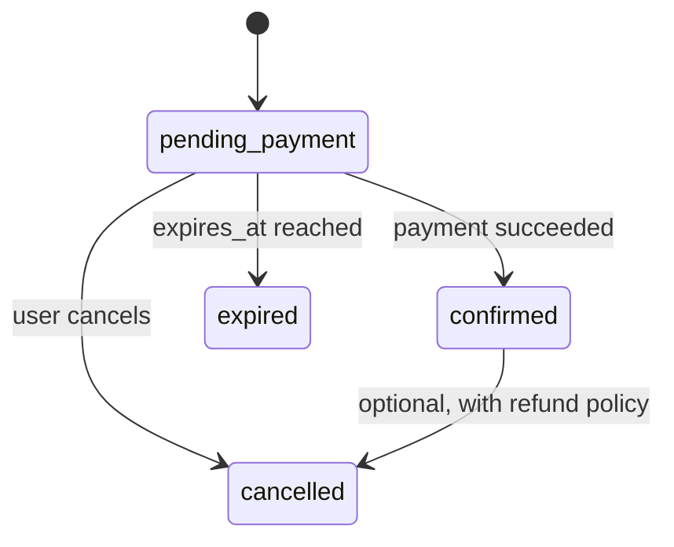

# ARCHITECTURE

## Visión general

Cliente → API FastAPI → servicios (lógica de negocio) → PostgreSQL.
Proveedor de pagos externo → webhooks → API.
Tareas en segundo plano (expiración de reservas) → servicios → PostgreSQL.

## Modelo de datos inicial (borrador: discutir antes de migrar)

- `users`: id, email (único), password_hash, role (`customer` | `admin`), created_at
- `resources`: id, name, description, price_cents, currency, active
- `bookings`: id, user_id, resource_id, starts_at, ends_at, status, total_cents, currency, expires_at, created_at
  - `total_cents` / `currency` congelan el precio al momento de reservar (el precio del recurso puede cambiar después).
- `payments`: id, booking_id, amount_cents, currency, status, provider, provider_payment_id, created_at
- `webhook_events`: id, provider, provider_event_id (único por provider), payload (jsonb), received_at, processed_at
  - El evento se guarda **antes** de procesarlo; así un reintento o un duplicado no se pierde ni se procesa dos veces.
- `idempotency_keys`: id, user_id, key, request_hash, response_status, response_body, created_at — único (user_id, key)

> Ojo: "idempotency key" aparece en dos lugares distintos. (a) La que **mi cliente** manda a **mi API** → tabla `idempotency_keys`. (b) La que **yo** mando al **proveedor de pagos** al crear un pago, si la soporta → posible columna en `payments`. Decidir en S5.

## Estados

- Payment: `pending` → `succeeded` | `failed`; `succeeded` → `refunded` (opcional, fuera del MVP).
- Definir transiciones válidas y **dónde viven** (un solo módulo en `services/`).

## Restricciones clave a nivel base de datos

- Exclusión de solapamiento por recurso sobre un rango de tiempo (investigar `tstzrange`, `EXCLUDE USING gist`, extensión `btree_gist`).
- Unicidad: `webhook_events (provider, provider_event_id)` e `idempotency_keys (user_id, key)`.
- `CHECK (ends_at > starts_at)`, montos positivos, estados/roles restringidos (enum o CHECK).
- Claves foráneas y NOT NULL donde corresponda.

## Preguntas abiertas (para pensar con el tutor)

1. ¿Qué estados de reserva deben bloquear el turno? ¿Cómo lo expresa la constraint para que una reserva `expired` o `cancelled` no bloquee?
2. Una reserva vencida que el job todavía no marcó como `expired`: ¿sigue bloqueando el turno? ¿Cómo evito bloquear de más?
3. Expiración: ¿tarea periódica, verificación al consultar, o ambas?
4. ¿Qué pasa si el pago llega después de que la reserva expiró? (confirmar si el turno sigue libre, reembolsar, otra cosa → ADR)
5. ¿Qué pasa si el webhook llega antes de que mi sistema haya guardado el pago?
6. ¿Slots de duración fija o rangos libres? ¿Horarios de atención y zona horaria por recurso?
7. ¿Qué nivel de aislamiento usa PostgreSQL por defecto y alcanza para cada caso?